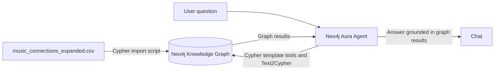

# Music Discovery Assistant

A GraphRAG agent that answers plain-language questions about musicians and bands by querying a Neo4j knowledge graph. Ask how two artists are connected, who was in a band, or which side projects a band's members played in, and the agent answers only from what the graph returns.

Built with Neo4j Aura Agent, Cypher template tools, and Text2Cypher.

## Demo

`music-discovery.mov` shows the agent answering questions in real time.

## Results

Scored on 20 test questions, each checked against the source CSV:

- Version 1: 1 of 4 correct. All three Cypher tools failed inside the chat with "parameter(s) is missing", so the agent answered from model memory and contradicted the graph.
- Version 2: 19 of 20 correct after fixing the tools and tightening the prompt. The one miss was a case-sensitive genre match in a Text2Cypher query; after adding schema guidance to the tool, the retest passed.

The agent repeats the graph even when it differs from well-known facts, which shows it is grounded in the data rather than memory. Full questions, expected answers, scores, and fixes are in [test_results.md](test_results.md).

## How it works



Graph model: `(:Artist {ArtistName})-[:MEMBER_OF {Role, Connection}]->(:Band {name, genre, formedYear})`

The agent has four tools:

| Tool | Type | Use |
|------|------|-----|
| Find Music Entity Connection Path | Cypher template | Shortest path between two artists or bands through shared members (up to 5 hops) |
| Get Band Roster and Musical Roles | Cypher template | Members of a band and their roles |
| Explore Bands by Member's Other Projects | Cypher template | Other bands a band's members played in, grouped by band |
| Natural Language to Cypher Tool | Text2Cypher | Counts, rankings, and other questions the templates don't cover |

## Dataset

- 1,028 artists, 210 bands, 1,142 memberships
- 102 artists belong to two or more bands, which gives the agent supergroups and side projects to find
- Source: [Wikidata](https://www.wikidata.org/) band memberships (CC0), built by `expand_music_connections.py` on top of the original 35 hand-entered rows in `music_connections.csv`

## Files

| File | Purpose |
|------|---------|
| `music_connections_expanded.csv` | Full dataset used by the agent |
| `music_connections.csv` | Original 35-row dataset |
| `expand_music_connections.py` | Pulls band memberships from Wikidata to build the expanded dataset |
| `neo4j_importer_cypher_script_2026-07-29.cypher` | Creates constraints and loads artists, bands, and memberships |
| `Music Discovery Assistant.json` | Agent configuration exported from Aura |
| `test_results.md` | 20-question evaluation, fixes, and known data limits |

## Run it yourself

1. Create a free AuraDB instance at [console.neo4j.io](https://console.neo4j.io) and save the password somewhere safe.
2. Open the Query tab and run `neo4j_importer_cypher_script_2026-07-29.cypher`. It loads the CSV straight from this repo.
3. Check the import:
   ```cypher
   MATCH (a:Artist) RETURN count(a);           // 1028
   MATCH (b:Band) RETURN count(b);             // 210
   MATCH ()-[r:MEMBER_OF]->() RETURN count(r); // 1142
   ```
4. Go to Agents, create an agent from scratch connected to the instance, and add the prompt and four tools from `Music Discovery Assistant.json`. For each Cypher template tool, add its parameters before pasting its query.
5. Ask a question in a new chat, for example "How is Nirvana connected to Paramore?"

Free Aura instances pause after 3 days without use and are deleted after 30 days paused. Everything needed to rebuild is in this repo.

## Known limits

- Roles come from each artist's instruments on Wikidata, not their role in a specific band (for example, Greg Lake is listed as Acoustic Guitar / Harmonica in King Crimson).
- Artists and bands are matched by name, so different people or bands with the same name share one node (two musicians named Mick Jones; two bands named Nirvana).
- Some rosters include later or reunion members, 53 bands have genre "Unknown", and 75 have no formed year.
- The graph covers 1,028 artists, so many real connections are missing.

See [test_results.md](test_results.md) for details.
